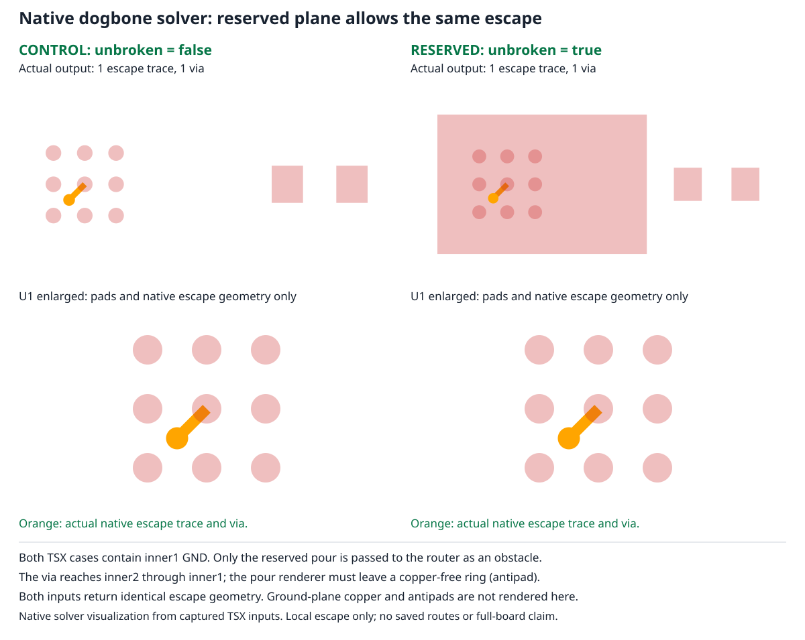

# Reproduction: reserved ground plane blocks a dogbone escape

Related design proposal: [#4](https://github.com/tscircuit/dogbone-solver/pull/4).
This PR adds a plain TSX example, captured native inputs, and a solver snapshot.
It does not implement the proposal. No dependencies are added or upgraded.

```sh
bun install
bun test tests/unbroken-plane.test.ts
```



The standalone [TSX example](../examples/unbroken-plane.circuit.tsx) explicitly
lists all nine pads of a 0.8 mm pitch grid. One center-pad SIGNAL connection
escapes from top to inner2 across an inner1 GND pour. Both cases contain that
pour; only its `unbroken` prop changes. `routeRemaining={false}` isolates local
escape, so the resistor intentionally stays unrouted.

| Only changed TSX prop | Published core output | Repository dogbone solver |
| --- | --- | --- |
| `unbroken={false}` | 1 escape trace, 1 via | Solved |
| `unbroken={true}` | 0 escape traces, 0 vias | Failed |

The error is `No complete local dogbone assignment within clearance/search limits`.
Expected: the SIGNAL via crosses inner1 GND with a copper-free ring (antipad),
keeping the nets isolated. The props API explicitly permits such crossings.

The JSON fixtures are unmodified `solver:started` constructor inputs captured
from the TSX example with stock core 0.0.2323 and props 0.0.724. They contain no
saved routes (`traces: []`). The test runs this repository's native solver and
checks that the only input difference is the reserved inner1 pour obstacle.
The source-pad ID is present in both inputs. The snapshot uses `solver.visualize()`
and the repository's existing graphics-debug/bun-match-svg tools. Its enlarged
views omit the plane/resistor rectangles for readability; solver inputs stay
unchanged. No output routes are drawn by the test.

The single test in `unbroken-plane.test.ts` records both current outcomes and
the explanatory snapshot. Passing CI means the reproduction is stable, not that
the routing bug is fixed. After a fix, update the failure assertions to require
a successful escape and regenerate the snapshot.

The relevant code is `lib/dogbone-fanout-solver.ts`, which passes all obstacles to
`matchComponentDogboneViaSites`. The shared `viaSiteClearsObstacles` helper in
`@tscircuit/fanout-solver` rejects the pour geometrically. A fix must retain real
obstacle clearance and verify emitted antipads/foreign-net isolation in core.

## Re-render the TSX and recapture inputs

The solver repo has no tscircuit renderer dependency. Copy the two files from
`examples/` into an existing tscircuit project, then run with Bun:

```sh
bun examples/capture-unbroken-plane.mjs
```

This renders both ordinary TSX cases, prints native trace/via/error counts, and
writes `unbroken-plane-ordinary.json` and `unbroken-plane-reserved.json` in that
project's working directory. Copy these inputs into `tests/fixtures/` here.
The capture only observes events; it never replaces the router or edits input.

The example's TSX tags are provided by core, so standalone circuit examples are
excluded from this solver-only tsconfig. The example was separately typechecked
and rendered in the existing tscircuit project. Its SHA-256 at capture time is:
`016a83e05b924a9dbe1979567a1066cc4caf9488911f6442bfc9aeca8a9c04ce`.

This small case isolates the defect. It does not establish that fixing it will
route an entire motherboard; that requires a separate board-level rerun.

To intentionally regenerate the solver snapshot:

```sh
BUN_UPDATE_SNAPSHOTS=1 bun test tests/unbroken-plane.test.ts
```
